

  CONFERENCE KEYNOTE // DISTRIBUTED SYSTEMS & INTERNET LORE
  <h1>From eMule MP3s to the Decentralized Web</h1>
  <h3 class="text-cyan">The Crazy History of Peer-to-Peer (1999 – 2026)</h3>
  
How teenage digital heist adventures, stubborn donkeys, and game theory accidentally engineered the backbone of the modern internet.

  

    

      eMule v0.42g - [Transfers: 1 file(s)]
      _□×
    

    

      

        Linkin_Park_-_In_The_End_REAL_HQ_2002.mp3
        3.42 MB / 3.43 MB (99.9%) — 1/48 Sources
      

      

        

          

          

          

          

        

      

      
Status: Waiting for peer [DarkSasuke91] in Ljubljana (Queue Rank: #1,492)...

    

  

Note:
[00:00 - 01:30]
Welcome everyone! Raise your hand if that progress bar at the bottom of the screen triggers mild post-traumatic stress disorder.
Today we are going on a 25-year journey: from the chaotic days of downloading questionable MP3s on the family computer to the cutting-edge distributed systems that power today's cloud, streaming platforms, and the decentralized web.

----

## 4:30 PM, October 2003: The After-School Ritual

  

    <h3>The Scene in the Living Room</h3>
    <ul>
      <li>You just got home from middle school with a bowl of cereal.</li>
      <li>The family Pentium III has been humming like a jet engine since 7:00 AM.</li>
      <li>The <strong>Sagem Fast 800 USB ADSL modem</strong> (512 kbps down / 128 kbps up) is blinking furiously.</li>
      <li>Nobody is allowed to touch the phone without an <strong>ADSL micro-filter</strong>.</li>
      <li>You double-click the little donkey icon in the system tray to inspect the day's harvest...</li>
    </ul>
  

  

    <h3>The 3 Stages of P2P Grief</h3>
    
07:15 AM Queued 4 songs & 1 movie trailer before school.

    
04:30 PM 3 files still at <code>Waiting...</code>, 1 file at <code>100% Completed</code>!

    
04:32 PM You open it in Winamp... and chaos ensues.

  

Note:
[01:30 - 03:00]
Picture this: It's October 2003. You come home from middle school. You left the family PC running all day with the monitor turned off so your parents wouldn't notice it was on.
Your ADSL connection is sputtering at 50 kilobytes per second, and after waiting nine hours, you finally see "Completed" in green.

----

## The Russian Roulette of Early-2000s Filenames

  

    Kazaa Media Desktop v2.0.2 — Search Results for "Linkin Park"
    _□×
  

  

    <table>
      <thead>
        <tr>
          <th>Filename</th>
          <th>Size</th>
          <th>Bitrate</th>
          <th>Peer</th>
          <th>Actual Payload</th>
        </tr>
      </thead>
      <tbody>
        <tr>
          <td class="text-red"><code>Linkin_Park_-_Numb_FULL_ALBUM.mp3.exe</code></td>
          <td>44 KB</td>
          <td>—</td>
          <td>xX_Neo_Xx</td>
          <td>Trojan.Win32.SubSeven (RIP Family PC)</td>
        </tr>
        <tr>
          <td class="text-amber"><code>Linkin_Park_-_In_The_End_HQ.mp3</code></td>
          <td>3.8 MB</td>
          <td>128 kbps</td>
          <td>RIAA_Bot_42</td>
          <td>30s loop + 3 mins of screeching static</td>
        </tr>
        <tr>
          <td class="text-cyan"><code>System_Of_A_Down_-_Zelda_Theme.mp3</code></td>
          <td>2.9 MB</td>
          <td>192 kbps</td>
          <td> Sk8erBoi</td>
          <td>Misattributed track (Actually Rabbit Joint)</td>
        </tr>
        <tr>
          <td class="text-green"><code>Matrix_Reloaded_DVDRip_FR_TRUEFRENCH.avi</code></td>
          <td>699 MB</td>
          <td>DivX 5</td>
          <td>MuleKing</td>
          <td>1978 German nature documentary (or worse)</td>
        </tr>
      </tbody>
    </table>
  

> <strong>Universal Truth of 2003:</strong> If a 3-hour movie was <code>28 KB</code> and ended in <code>.vbs</code> or <code>.exe</code>, you learned cybersecurity the hard way before age 14.

Note:
[03:00 - 04:15]
Peer-to-Peer was Russian Roulette.
1. First, the `.mp3.exe` — Windows XP hid known file extensions by default! So `Numb.mp3.exe` just looked like `Numb.mp3` with a suspiciously pixelated icon.
2. Second, the Bill Clinton clip ("I did not have sexual relations with that woman") or Madonna swearing at you ("What the f*** do you think you're doing?").
3. Third, the 700 MB `.avi` file that took 4 days to download so it would fit on a single CD-R, only for you to preview it with VLC and realize it was definitely NOT *The Matrix Reloaded*.

----

## The "Stuck at 99.9%" Syndrome & `.part` File Archaeology

  

    <h3>The Final 180 KB Heartbreak</h3>
    

      

        

        

        

        

      

    

    <ul>
      <li><code>699.8 MB / 700.0 MB (99.9%)</code> — Red bar on the very last chunk for <strong>11 days</strong>.</li>
      <li>Only 1 complete source exists (<code>[ITA]Gianni84</code>), and he only turns on his PC on Sunday afternoons.</li>
      <li>eMule chat message begging: <em>"Plz friend slot!! Need last 200KB!!"</em></li>
    </ul>
  

  

    <h3>The Teenager's Survival Toolkit</h3>
    <ul>
      <li><strong>VLC Media Player:</strong> Navigating to <code>C:\Program Files\eMule\Temp\004.part</code> to preview half-downloaded <code>.avi</code> files with missing keyframes!</li>
      <li><strong>DivX ;-) & K-Lite Codec Pack:</strong> Installing 47 sketchy video codecs hoping the green screen disappears.</li>
      <li><strong>Nero Burning ROM:</strong> Burning the <code>702 MB</code> file onto a <code>700 MB</code> Verbatim CD-R using <em>Overburn</em> while praying <code>Buffer Underrun</code> doesn't turn your disc into a coaster.</li>
    </ul>
  

Note:
[04:15 - 05:15]
And who remembers `C:\Program Files\eMule\Temp`?
Because downloads took days, you couldn't wait until 100% to find out if the movie was a fake! You opened `004.part` directly in **VLC Media Player**—which became famous specifically because it could play incomplete `.part` AVI files without the index header at the end of the file!
And when a file sat at 99.9% with one tiny red bar left, you'd sit there watching one guy in Italy go online and offline, praying he wouldn't delete the file from his `Incoming` folder before you got the last 180 kilobytes.

----

## Why This Folklore Actually Matters

  

    
70%+

    
<strong>of Global Internet Traffic</strong> in 2004–2007 was Peer-to-Peer packets (ipoque / CacheLogic studies).

  

  

    
0 $

    
<strong>Server Budget.</strong> Millions of concurrent users trading petabytes with zero cloud infrastructure.

  

  

    
25 Years

    
<strong>of Distributed Systems R&D</strong> under live adversarial conditions (lawsuits, ISP throttling, poisoning).

  

### The Core Thesis of This Talk
Behind the moral panic and the teenage digital heists lay <strong>the largest adversarial distributed systems laboratory in computing history</strong>. Every time the courts or record labels broke a protocol, P2P engineers invented a more resilient network topology.

Note:
[04:30 - 06:00]
Why are we talking about this at a tech conference? Because at its peak around 2005, P2P accounted for over 70% of all residential internet traffic worldwide.
And more importantly: these networks operated under **Byzantine, adversarial conditions**. Court injunctions shut down central servers; ISPs throttled ports; security firms injected millions of poisoned files; 85% of users were selfish free-riders.
Solving those four problems gave birth to the distributed algorithms we use every single day.

----

## Talk Roadmap: 5 Acts of Decentralization

  

    
ACT I — GEN 1 (1999–2001)

    <h3>Napster & The Central Server Fallacy</h3>
    
Shawn Fanning, Metallica's 13 boxes of paper, and why a central index is a single point of failure.

  

  

    
ACT II — GEN 2 (2000–2005)

    <h3>Gnutella, Kazaa, eMule & The Poisoning Wars</h3>
    
Query flooding meltdowns, Supernodes, LowID vs. HighID, chunk hashes, and RIAA sabotage.

  

  

    
ACT III — GEN 3 (2001–2010)

    <h3>BitTorrent, Kademlia DHT & Game Theory</h3>
    
Bram Cohen's swarming, Tit-for-Tat choking, XOR metric ($x \oplus y$) routing in $O(\log N)$.

  

  

    
ACTS IV & V — 2010 TO TOMORROW

    <h3>Modern Infra & The Decentralized Web</h3>
    
How P2P built Spotify, Skype, Windows Update, Uber Kraken, WebRTC, IPFS, and libp2p.

  

Note:
[06:00 - 06:45]
Here is our roadmap for the next 38 minutes. We'll walk through the three generations of P2P architecture, then look under the hood of modern streaming and cloud infrastructure, and finally explore how IPFS and libp2p are redesigning the web itself.

---

  ACT I // GENERATION 1 (1999 – 2001)
  <h1>Napster & The Central Index Achilles' Heel</h1>
  
How an 18-year-old college dropout broke the music industry in 6 months — and why his architecture couldn't survive a courtroom.

Note:
[06:45 - 07:15]
Let's rewind to 1999. Act I: Generation 1 P2P and the Napster revolution.

----

## Before Napster (1978–1998): BBSes, Fidonet, FTP & The Client-Server Wall

  

    <h3>The Pre-P2P Underground (1978–1998)</h3>
    <ul>
      <li><strong>1978–1984 (Dial-Up Pioneers):</strong> Ward Christensen's <strong>CBBS</strong> &amp; <code>XMODEM</code>, <strong>Usenet</strong> (<code>alt.binaries</code>, 1979), and <strong>Fidonet (1984)</strong> — a nocturnal store-and-forward dial-up mesh linking independent BBSes!</li>
      <li><strong>1990s Scene &amp; Communities:</strong> Shady <strong>Ratio FTPs</strong> (<em>"Upload 1 MB to download 3 MB"</em>), IRC <code>#mp3</code> <strong>XDCC / Fserve bots</strong>, and <strong>Hotline Communications (1997)</strong>.</li>
      <li><strong>1998 Web Agony:</strong> Searching AltaVista for <code>"index of /mp3"</code> and clicking 14 dead GeoCities links (<code>HTTP 404</code> / <code>Bandwidth Limit Exceeded</code>).</li>
    </ul>
  

  

    <h3>The Client-Server Paradox</h3>
    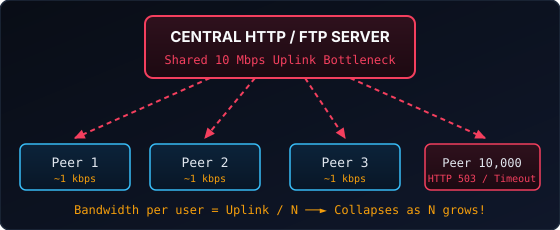
    
<strong>In HTTP/FTP:</strong> Popularity is a curse. The more people want a file, the slower the server gets.

  

Note:
[07:15 - 08:30]
Digital file sharing didn't start in 1999—it goes back to **CBBS (1978)**, **Usenet's `alt.binaries` (1979)**, and **Fidonet (1984)**, where hobbyist Bulletin Board Systems automatically dialed each other late at night when phone rates were cheap to relay messages and files across the world!
By the mid-1990s, you had **IRC XDCC bots**, **Ratio FTP servers**, and **Hotline (1997)**—a legendary Mac/PC community app where you logged into custom servers to chat and trade software and MP3s.
In 1998, the Fraunhofer Institute's MP3 codec compressed a 50 MB WAV song down to 4 MB, and Nullsoft's Winamp ("It really whips the llama's ass!") was on every PC.
But finding MP3s on the Web was miserable! Why? Because HTTP and FTP are **Client-Server**. If a college student put a hit song on a GeoCities or university FTP server, 500 people would click it and immediately saturate the server's network card. Popularity killed availability.

----

## June 1999: Shawn Fanning & Dorm Room 300

  

    <h3>The Birth of Napster</h3>
    <ul>
      <li><strong>Shawn Fanning</strong> ("Napster", a nickname for his curly hair) is an 18-year-old freshman at Northeastern University in Boston.</li>
      <li>His roommate complains that MP3 links on Lycos are always dead while millions of songs sit idle on dorm PCs.</li>
      <li>Fanning skips classes, codes in C++ for 3 months straight, teams up with <strong>Sean Parker</strong> (whom he met on IRC), and releases <strong>Napster v2.0 Beta</strong> in June 1999.</li>
      <li>By February 2000: <strong>20+ million users</strong>. Fastest-growing software in history at the time.</li>
    </ul>
  

  

    <h3>The Core Insight</h3>
    <blockquote>
      "Why index static web servers that go offline, when you can index the live hard drives of everyone currently connected?"
    </blockquote>
    
Every consumer becomes a micro-server. Storage and bandwidth scale <em>with</em> the user base.

  

Note:
[08:30 - 09:45]
Shawn Fanning had a simple but radical insight in his dorm room at Northeastern University. His roommate was frustrated by broken FTP links, while thousands of students on the same campus LAN had gigabytes of MP3s sitting idle on their hard drives.
Fanning teamed up with Sean Parker—whom he met on an IRC hacking channel—and launched Napster in June 1999.

----

## Napster Architecture: Hybrid P2P (Central Index)

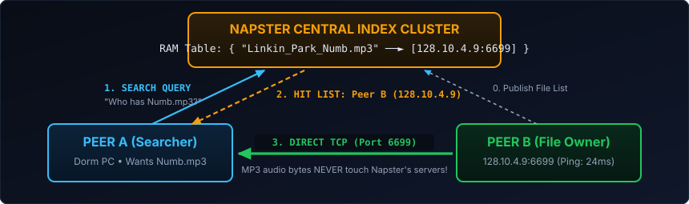

  

    <strong>Step 1: Register</strong> Client connects to central server and uploads its local <code>*.mp3</code> file list.
  

  

    <strong>Step 2: Matchmaking</strong> Central server searches its in-memory index and returns matching peer IPs + line speeds (T1, Cable, 56k).
  

  

    <strong>Step 3: Direct P2P</strong> Peer A opens a direct TCP socket to Peer B. Napster pays <strong>zero</strong> audio bandwidth cost!
  

Note:
[09:45 - 10:45]
Architecturally, how did Napster work? We call it **Generation 1 (Hybrid P2P)**.
Look at the diagram:
1. When you sign in, your client sends a list of your MP3 filenames and bitrates to Napster's central servers in California.
2. When Peer A searches for a song, the query goes to the central server, which replies with a list of IP addresses.
3. Step 3 is the magic: Peer A connects *directly* to Peer B over TCP port 6699. Not a single byte of MP3 audio ever passes through Napster's servers!
This was brilliant economically—Napster didn't have to pay for MP3 bandwidth—but legally and architecturally, look at that giant box at the top.

----

## Late 1999: The University Campus Bandwidth Crisis

  

    <h3>Why Dorm Rooms Melted University Routers</h3>
    <ul>
      <li>In 1999, home users had <strong>56k dial-up</strong>, while college dorm rooms had <strong>100 Mbps Ethernet</strong> connected to university T3 backbones.</li>
      <li>Napster displayed connection speed next to every search result (<code>T1</code>, <code>T3</code>, <code>Cable</code>, <code>56k</code>).</li>
      <li><strong>Result:</strong> Millions of dial-up users worldwide exclusively picked university peers to download from!</li>
    </ul>
  

  

    <h3>Campus Network Telemetry (Fall 1999)</h3>
    <ul>
      <li><strong>Indiana University & Oregon State:</strong> Over <strong>60% to 75%</strong> of total external campus internet traffic was outbound Napster MP3 transfers.</li>
      <li>Over <strong>200 US universities</strong> banned port <code>6699</code> before the RIAA even won in court — triggering the first wave of <strong>port-hopping and DPI (Deep Packet Inspection)</strong> cat-and-mouse games.</li>
    </ul>
  

Note:
[10:45 - 11:30]
Before Metallica even showed up, Napster caused an infrastructure crisis on university campuses.
Why? Because in 1999, most homes still had 56k modems, while university dorms had 100 Mbps Ethernet hooked up to T3 lines. Napster helpfully showed the line speed (`T3`, `T1`, `56k`) in search results—so the entire planet clicked on college students' PCs!
At Indiana University and Oregon State, network admins woke up to find 75% of their entire campus internet pipe saturated by outbound MP3 traffic. Over 200 universities blocked port 6699, sparking the very first port-hopping arms race.

----

## April 2000: Metallica, Dr. Dre & 13 Boxes of Paper

  

    <h3>The "I Disappear" Incident</h3>
    <ul>
      <li><strong>April 2000:</strong> Metallica discovers an unreleased studio demo of <em>"I Disappear"</em> (recorded for the <em>Mission: Impossible 2</em> soundtrack) is already playing on US radio stations.</li>
      <li>They trace the leak to Napster — along with their entire studio discography.</li>
      <li><strong>May 3, 2000:</strong> Drummer <strong>Lars Ulrich</strong> drives to Napster HQ in San Mateo with <strong>13 boxes containing 60,000 pages</strong> listing <strong>335,435 Napster usernames</strong> demanding they be banned.</li>
    </ul>
  

  

    <h3>A&M Records v. Napster, Inc. (2001)</h3>
    <ul>
      <li>Napster's defense: <em>"We're just a search engine! The files aren't on our servers!"</em></li>
      <li>Court's ruling: Because you operate the <strong>central index</strong>, you have the ability and legal duty to police and block copyrighted tracks.</li>
      <li><strong>July 2001:</strong> Ordered to block 99.4% of infringing files, Napster shuts down its central servers.</li>
    </ul>
    
<strong>Architectural Lesson #1:</strong> A decentralized data plane with a centralized control plane still has <strong>one throat to choke</strong>.

  

Note:
[11:15 - 12:45]
First, universities started banning Napster because students on 100 Mbps dorm networks were consuming up to 75% of campus internet capacity.
Then came April 2000: Metallica's unreleased track "I Disappear" starts playing on radio stations across America before it's even mastered. Metallica hires consulting firm NetPD, logs 335,435 usernames sharing their songs, prints out 60,000 pages of paper in 13 boxes, and Lars Ulrich personally delivers them to Napster's lobby.
In *A&M Records v. Napster*, the 9th Circuit Court ruled that because Napster controlled the central index server, it had both knowledge and control over the network.
In July 2001, someone unplugged the central index cluster. And in one second, an 80-million-user network vanished.
The lesson for every hacker watching around the world was crystal clear: **Never build a central server again.**

---

  ACT II // GENERATION 2 (2000 – 2005)
  <h1>Cut Off One Head: Gnutella, Kazaa & eMule</h1>
  
From pure flooding anarchy to Supernodes, stubborn donkeys, HighID port forwarding trauma, and the RIAA poisoning wars.

Note:
[12:45 - 13:15]
Act II: Generation 2 P2P. While Napster was still fighting in court in early 2000, the next generation was already being written. And its motto was: "Cut off one head, two more shall take its place."

----

## March 14, 2000: Gnutella & The 24-Hour Rebel Release

  

    <h3>Justin Frankel's Renegade Commit</h3>
    <ul>
      <li><strong>Justin Frankel</strong> (21, creator of Winamp at Nullsoft) and <strong>Tom Pepper</strong> watch the Napster lawsuit unfold.</li>
      <li>Wait: AOL had just acquired Nullsoft (for $86M) — and AOL was merging with <strong>Time Warner</strong> (one of the major labels suing Napster!).</li>
      <li>On <strong>March 14, 2000</strong>, without asking AOL executives, they post <code>gnutella 0.56</code> on Nullsoft's servers: <em>"GNU + Nutella"</em>.</li>
      <li>AOL panics and pulls the binary down in <strong>less than 24 hours</strong>.</li>
      <li><strong>Too late:</strong> Thousands had downloaded it, and within 4 days, clean-room reverse-engineered open specs appeared, spawning <strong>LimeWire, BearShare, Morpheus, and Shareaza</strong>.</li>
    </ul>
  

  

    <h3>Zero Central Servers</h3>
    
How can you shut down a company when:

    <ol>
      <li>There is no company.</li>
      <li>There is no central server.</li>
      <li>Every desktop client is simultaneously a <strong>Client</strong> AND a <strong>Server</strong> (a <em>"Servent"</em>).</li>
    </ol>
  

Note:
[13:15 - 14:45]
Enter Justin Frankel—the legendary 21-year-old creator of Winamp. Nullsoft had just been bought by AOL, which was in the middle of merging with Time Warner, one of the giant record labels suing Napster!
On March 14, 2000, Frankel and Tom Pepper quietly upload a tiny program called Gnutella to Nullsoft's website.
AOL executives find out the next day, freak out, and unplug the download server within 24 hours.
But 24 hours on the internet is eternity. Hackers reverse-engineered the wire protocol over the weekend. And because Gnutella had NO central server, AOL couldn't turn it off!

----

## Gnutella 0.4 Architecture: Unstructured Query Flooding

  

    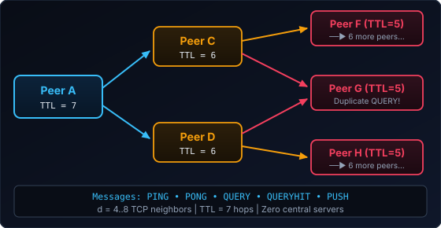
  

  

    <h3>The August 2000 Flooding Meltdown</h3>
    
If each peer forwards a query to $b$ neighbors across $\text{TTL}$ hops, a single search generates:

    
$$M = \sum_{i=1}^{\text{TTL}} b \cdot (b-1)^{i-1} \approx O\left(b^{\text{TTL}}\right)$$

    <ul>
      <li>With $b=6$ and $\text{TTL}=7$: <strong>~55,986 packets per search!</strong></li>
      <li>When Napster users flooded onto Gnutella in Aug 2000, <strong>56k dial-up peers choked</strong> on <code>PING</code>/<code>QUERY</code> traffic, partitioning the entire overlay network.</li>
    </ul>
  

Note:
[14:45 - 16:15]
How did Gnutella 0.4 work without a central server? **Unstructured Query Flooding**.
When you search for a file, you send a `QUERY` packet to your 5 or 6 connected neighbors with a Time-To-Live (`TTL`) of 7. Each neighbor forwards it to all of *their* neighbors with `TTL=6`, and so on.
Look at the math on the right: $O(b^{\text{TTL}})$. If every node has 6 neighbors and TTL is 7, a single person typing "Linkin Park" generates over 55,000 packets across the network!
And worse: Gnutella treated all peers equally. A college student on a 100 Mbps fiber line was forwarding thousands of queries through a grandma on a 28.8 kbps dial-up modem. In August 2000, Gnutella suffered a total network collapse under its own query overhead.

----

## 2001: FastTrack (Kazaa) & The Supernode Revolution

  

    <h3>Not All Peers Are Created Equal</h3>
    
Created by <strong>Jaan Tallinn, Ahti Heinla &amp; Priit Kasesalu</strong> (Estonia) with founders <strong>Niklas Zennström &amp; Janus Friis</strong> (Sweden/Denmark).

    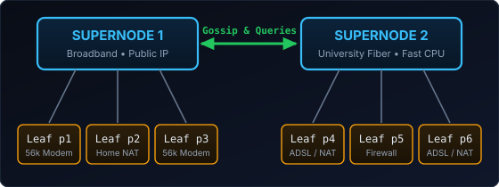
    <ul>
      <li><strong>Self-Organizing Two-Tier Hierarchy:</strong> High-CPU, high-bandwidth, non-firewalled nodes automatically promote themselves to <strong>Supernodes</strong> (Gnutella later adopted this as <em>Ultrapeers</em>).</li>
      <li>Leaf nodes only index their files with their local Supernode. Queries only travel between Supernodes!</li>
    </ul>
  

  

    <h3>Wait... Recognize Those Names?</h3>
    
By 2003, <strong>Kazaa</strong> was the most downloaded software in history (<strong>300M+ downloads</strong>).

    

    
<strong>Fun Fact #1:</strong> In 2003, the exact same founders & Estonian engineers took the FastTrack Supernode P2P engine, swapped files for encrypted UDP voice packets, and launched <strong>Skype</strong>!

    
That's why early Skype used your CPU & bandwidth in the background if you had a public IP — your PC was a voice Supernode!

  

Note:
[16:15 - 17:30]
How do you fix Gnutella's flooding meltdown without bringing back Napster's single server?
In March 2001, three brilliant Estonian programmers—Jaan Tallinn, Ahti Heinla, and Priit Kasesalu—working with Niklas Zennström and Janus Friis, released the **FastTrack** protocol and **Kazaa**.
Their insight: **Not all peers are equal.** Instead of a flat network, FastTrack automatically detects which users have fast CPUs, broadband connections, and public IP addresses, and dynamically promotes them to **Supernodes**.
Slow dial-up users become "leaf nodes" connected to a Supernode. Queries only bounce between Supernodes, cutting network overhead by 99%!
And here's one of the best plot twists in tech history: two years later, that exact same team took the Kazaa Supernode engine, replaced file transfers with voice codecs, and created **Skype**! If you ever wondered why Skype in 2005 ate your bandwidth even when you weren't on a call—congratulations, if you had a public IP, Skype turned your PC into a relay Supernode for other people's phone calls!

----

## Direct Connect (`DC++`), Soulseek & Multi-Network Legends

  

    <h3><code>DC++</code> (1999) &amp; <code>Soulseek</code> (2000 — Still Alive Today!)</h3>
    <ul>
      <li><strong>Direct Connect &amp; DC++ (1999/2001):</strong> Built around community <strong>Hubs</strong> (<code>dchub://</code>) on university dorm LANs &amp; Nordic fiber. Enforced strict <strong>"Minimum 50 GB Share"</strong> gates verified by <strong>TTH (192-bit Tiger Tree Hashes)</strong> so students couldn't fake quotas by sharing <code>C:\Windows</code>!</li>
      <li><strong>Soulseek (Oct 2000, Nir Arbel — ex-Napster dev):</strong> Built for underground electronic &amp; indie crate-diggers. Lets you browse full album folder trees, set persistent <em>Wishlists</em>, and has zero adware — <strong>still thriving in 2026!</strong></li>
      <li><strong>The Multi-Protocol Era:</strong> <strong>Audiogalaxy Satellite</strong> (1998–2002), <strong>WinMX</strong> (<code>OpenNap</code> + <code>WPNP</code>), and <strong>Shareaza</strong> (2001, connecting to <code>ed2k</code>, <code>Gnutella</code>, <code>G2</code> &amp; <code>BitTorrent</code> at once!).</li>
    </ul>
  

  

    <h3>"Minimum Share: 50 GB" &amp; Browsable Trees</h3>
    

      

        DC++ Hub Gatekeeper Bot
      

      

        <code>*** Disconnected: Minimum share is 50 GB and 3 open Upload Slots! (You share: 12.4 GB)</code>
      

    

    <ul>
      <li><strong>Human Curation Over Chaos:</strong> Both <strong>DC++</strong> and <strong>Soulseek</strong> proved that letting users <em>browse a peer's organized directory tree</em> beat blind keyword searches for rare albums and LAN parties.</li>
    </ul>
  

Note:
[17:30 - 18:30]
Before we talk about eMule, we have to salute the community legends that grew alongside Gnutella and Kazaa between 1999 and 2002:
1. First, **Direct Connect (1999)** and its open-source king **DC++ (2001)**. If you lived in a university dorm or went to LAN parties, DC++ was religion. You connected to community **Hubs** (`dchub://`), browsed other students' entire shared directory trees, and faced ruthless Hub gatekeeper bots: *"Minimum 50 GB shared required!"* When freshmen tried sharing `C:\Windows` or 20 GB of zero-filled dummy files to get in, DC++ rolled out **TTH (Tiger Tree Hashes)**—a 192-bit Merkle tree hash that caught fake files instantly!
2. Second, **Soulseek (October 2000)**, created by ex-Napster programmer Nir Arbel. While Kazaa was full of top-40 radio pop and malware, Soulseek became the sacred library for rare vinyl rips, underground electronic music, and full album folders—and remarkably, **Soulseek is still alive and thriving today in 2026**!
3. And we also had **Audiogalaxy Satellite** (the beloved web-triggered background agent shut down in 2002), **WinMX**, and **Shareaza** (2001), which could connect to eDonkey, Gnutella, Gnutella2, and BitTorrent simultaneously!

----

## eDonkey2000 & eMule (2002): The Stubborn Donkey

  

    <h3>Why "Merkur" Built eMule</h3>
    <ul>
      <li><strong>Sept 2000:</strong> <strong>Jed McCaleb</strong> (later founder of Mt. Gox, Ripple & Stellar) creates <strong>eDonkey2000 (<code>ed2k</code>)</strong>.</li>
      <li><strong>May 13, 2002:</strong> German developer <strong>Hendrik Breitkreuz ("Merkur")</strong> is frustrated with the closed, ad-heavy official eDonkey client and starts the open-source <strong>eMule</strong> project on SourceForge.</li>
      <li>Result: One of the most resilient, feature-packed C++ applications ever written (600M+ downloads).</li>
    </ul>
  

  

    <h3>What Made <code>ed2k</code> / eMule Revolutionary?</h3>
    <ol>
      <li><strong>Multi-Source Swarming (MFTP):</strong> Download different parts of the <em>same</em> file from 50 peers simultaneously!</li>
      <li><strong>9.28 MB Chunk Hashing (MD4):</strong> You don't wait until the end of a 700 MB file to discover a corrupted byte — every <code>9,728,000</code>-byte chunk is verified & shared while still downloading.</li>
      <li><strong>Credit System:</strong> Upload to a peer, earn priority score in their download queue.</li>
    </ol>
  

  

    Anatomy of an ed2k link:
    <code>ed2k://|file|Ubuntu_6.06_Dapper_Drake.iso|731162624|8E5F29A0B4C719D3E60A1F2B3C4D5E6F|/</code>
     — Immutable MD4 Root Hash! Filename can change, hash never lies.
  

Note:
[17:45 - 19:15]
Meanwhile, in Europe especially, another titan rose: **eDonkey2000** (created by Jed McCaleb) and its legendary open-source successor **eMule**, started in May 2002 by Hendrik Breitkreuz ("Merkur").
Kazaa had a huge flaw: filenames were not cryptographically tied to content, and multi-source downloading was primitive.
eMule introduced `ed2k://` links and **Chunk Hashing**. Every file was split into 9.28 MB chunks, each hashed with MD4, plus an AICH (Advanced Intelligent Corruption Handler) SHA-1 tree.
As soon as you finished downloading Chunk #1 of a 700 MB movie, eMule verified its hash and immediately started uploading Chunk #1 to other people, even while you were still missing Chunks #2 through #75!

----

## The Trauma of a Generation: High ID vs. Low ID

  

    <h3>HIGH ID The Chosen Ones</h3>
    
Globe Icon: 🟢 Two Green Arrows

    <ul>
      <li><strong>Port <code>4662</code> (TCP) & <code>4672</code> (UDP)</strong> are reachable from the outside internet.</li>
      <li>Can initiate AND accept direct connections with <strong>every peer</strong> (High ID + Low ID).</li>
      <li>Formula: <code>ID = A + 256·B + 256²·C + 256³·D</code> (Your actual public IPv4!).</li>
    </ul>
  

  

    <h3>LOW ID The NAT Purgatory</h3>
    
Globe Icon: 🟡 Blindfolded Mule / Yellow Arrows

    <ul>
      <li>Trapped behind a home router NAT or Windows XP SP2 Firewall (<code>ID &lt; 16777216</code>).</li>
      <li><strong>Two Low ID peers CANNOT talk to each other directly!</strong> Both sit behind NAT waiting for the other to connect first.</li>
      <li>Penalized or outright kicked from top servers like <em>Razorback 2.0</em> (<code>195.245.244.243</code>).</li>
    </ul>
  

> <strong>How Middle Schoolers Became Network Engineers:</strong> Millions of 13-year-olds learned static DHCP leases, NAT tables, and TCP/UDP port forwarding on <code>192.168.1.1</code> just to get rid of the yellow blindfold on the eMule donkey.

Note:
[19:15 - 20:30]
You cannot talk about eMule without talking about the trauma of **Low ID vs. High ID**.
Look at that icon in the bottom right corner of eMule: a little globe with two arrows. If the arrows were yellow—or worse, if the little donkey had a black blindfold over its eyes—you had a **Low ID**.
Why? Because in the early 2000s, ISPs started replacing USB modems with NAT routers (like the Livebox or Freebox in France, or Linksys WRT54G).
Behind a NAT router, outside peers can't open an incoming TCP connection to your PC on port 4662. So two Low ID users literally could not transfer files to each other!
eMule forced an entire generation of teenagers to log into `192.168.1.1`, understand the difference between TCP and UDP, configure static local IPs, and set up NAT port forwarding rules.

----

## The Dirty War (2003–2006): Poisoning, Decoys & Lawsuits

  

    <h3>1. Network Poisoning</h3>
    
Record labels hired companies like <strong>Overpeer</strong>, <strong>Loudeye</strong> & <strong>MediaDefender</strong>.

    <ul>
      <li>Injected <strong>hundreds of millions of decoy files</strong> with valid sizes & ID3 tags but filled with white noise or 20-second loops.</li>
      <li>Spoofed fake sources on eMule (<code>0 KB/s</code> trickling) to exhaust download queues.</li>
    </ul>
  

  

    <h3>2. Suing 12-Year-Olds</h3>
    
Between 2003 and 2008, the RIAA filed <strong>30,000+ lawsuits</strong> against individuals:

    <ul>
      <li><strong>Brianna LaHara (12 years old)</strong> in NYC public housing — settled for $2,000.</li>
      <li><strong>Sarah Seabury Ward (66-year-old grandmother)</strong> in Boston — accused of sharing 2,000 rap songs on Kazaa (she only owned a Macintosh that couldn't even run Kazaa!).</li>
    </ul>
  

  

    <h3>3. <em>MGM v. Grokster</em> &amp; Server Raids</h3>
    <ul>
      <li><strong>June 2005 (<em>MGM v. Grokster</em>):</strong> U.S. Supreme Court rules 9–0 that <strong>decentralized code is NOT a legal shield</strong> if a company <em>actively induces</em> infringement — killing commercial P2P startups (<em>Grokster, Morpheus, eDonkey's MetaMachine, LimeWire</em>).</li>
      <li><strong>Feb 2006:</strong> Belgian police raid <strong>Razorback 2.0</strong> (largest <code>ed2k</code> server indexing 1.3M users), while fake spy servers (<em>Sonnenschein</em>) harvest IPs.</li>
    </ul>
  

Note:
[20:30 - 21:30]
As P2P grew unstoppable technically, the entertainment industry escalated on three fronts between 2003 and 2006:
1. First: **Technical sabotage**. Companies like Overpeer and MediaDefender ran massive server farms injecting millions of poisoned MP3s and fake AVI chunks into Kazaa and eDonkey.
2. Second: **Suing end users**. The RIAA sued over 30,000 individuals, including a 12-year-old honors student in New York and a 66-year-old grandmother in Massachusetts accused of sharing Snoop Dogg songs on a Windows-only client when she only owned a Mac!
3. Third: **The Supreme Court & Server Raids**. After Napster, P2P startups assumed that as long as their network had no central server, they were protected by the 1984 *Sony Betamax* ruling. In **June 2005 (*MGM Studios, Inc. v. Grokster, Ltd.*)**, the U.S. Supreme Court shattered that illusion 9–0: if your business model *actively induces* copyright infringement, decentralization won't save you! That killed commercial P2P companies (Grokster, Morpheus, MetaMachine, LimeWire), leaving only non-commercial open-source software like **eMule** and **BitTorrent** standing—just as Belgian police seized **Razorback 2.0** in February 2006.

----

## How eMule Fought Back: AICH Merkle Trees & RSA Credits

  

    <h3>Defeating Poisoners: AICH (SHA-1 Trees)</h3>
    <ul>
      <li><strong>The Attack:</strong> Anti-piracy bots intentionally sent <strong>1 corrupted byte</strong> inside a <code>9.28 MB</code> chunk so eMule's MD4 check would discard the <em>entire</em> <code>9.28 MB</code> chunk!</li>
      <li><strong>The Countermeasure (AICH):</strong> eMule added a secondary <strong>Merkle Hash Tree</strong> of <code>180 KB</code> blocks using SHA-1.</li>
      <li>When a <code>9.28 MB</code> chunk failed MD4, eMule only re-downloaded the single poisoned <code>180 KB</code> sub-block and banned the attacking IP (<code>Ipfilter.dat</code> / PeerGuardian)!</li>
    </ul>
  

  

    <h3>Defeating "Leecher Mods": Asymmetric Credits</h3>
    <ul>
      <li>Shady modified clients (<em>DarkMule, LSD Mod</em>) tried to fake high upload statistics to skip queues.</li>
      <li><strong>eMule's Fix:</strong> Your credit score is <strong>never stored on your own PC</strong>! Each peer stores a local ledger of how much <em>you</em> uploaded to <em>them</em>, authenticated via <strong>384-bit RSA public-key signatures (<code>cryptkey.dat</code>)</strong>.</li>
    </ul>
  

Note:
[21:30 - 22:15]
Look at the cryptographic arms race that happened inside eMule to survive this war:
1. Poisoning bots realized eMule verified 9.28 MB chunks with MD4. So a bot would wait until you downloaded 9.27 MB from real users, then send you 10 KB of garbage at the end—forcing your client to throw away the whole 9.28 MB!
eMule engineers responded with **AICH (Advanced Intelligent Corruption Handler)**: a full SHA-1 Merkle tree over 180 KB blocks, allowing eMule to pinpoint the exact corrupted 180 KB slice, salvage 98% of the chunk, and ban the poisoner's IP!
2. And when "Leecher Mods" tried to cheat the queue system, eMule introduced RSA public-key cryptography (`cryptkey.dat`) and stored credits exclusively on the recipient's machine.

----

## 2004–2006: How the `Kad` Network Saved eMule From Extinction

  

    <h3>Surviving the Razorback 2.0 Raid</h3>
    <ul>
      <li>When Belgian police seized <strong>Razorback 2.0</strong> in Feb 2006 and anti-piracy firms spun up fake <code>ed2k</code> spy servers, why didn't eMule die like Napster?</li>
      <li>Because in 2004, eMule v0.40+ had quietly rolled out the <strong>Kad Network</strong> — the first planet-scale, serverless UDP <strong>Kademlia DHT</strong> (bootstrapped from a simple <code>nodes.dat</code> file!).</li>
      <li>Even if every <code>ed2k</code> server on Earth was unplugged, eMule clients could find peers and search files purely peer-to-peer via <strong>Kad</strong>.</li>
    </ul>
  

  

    <h3>How Kad Solved Serverless Keyword Search</h3>
    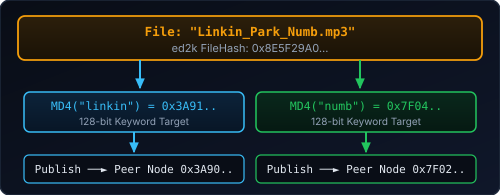
    <ul>
      <li><strong>Inverted DHT Index:</strong> Kad splits filenames into words, hashes each word with 128-bit MD4, and publishes the file pointer to nodes whose Kad ID is closest to that word's hash!</li>
      <li><strong>Kad "Buddy" Relays:</strong> Even firewalled <strong>Low ID</strong> users could receive incoming connections via a High ID <em>Kad Buddy</em> hole-punch coordinator!</li>
    </ul>
  

Note:
[22:15 - 23:00]
And how did eMule survive when Belgian police raided Razorback 2.0 in February 2006?
Because two years earlier, eMule developers had implemented the **Kad Network** (alongside the *Overnet* network)!
All you needed was a tiny file called `nodes.dat` containing a handful of peer IPs, and your eMule client joined a completely serverless UDP Kademlia network.
And look at the clever engineering on the right: standard DHTs only let you look up an exact file hash. How did eMule Kad let you type `"Linkin Park"` into a search box with no central server?
When you shared a file, eMule split the filename into individual keywords (`"linkin"`, `"park"`, `"numb"`), hashed each word with MD4 into a 128-bit target ID, and sent a publish packet to the eMule peers whose Node ID was closest to the hash of `"linkin"`! It built a **distributed, serverless full-text inverted search index** across millions of home PCs! Welcome to Act III!

---

  ACT III // GENERATION 3 (2001 – 2010)
  <h1>BitTorrent, Kademlia & Mathematical Invincibility</h1>
  
How Bram Cohen turned free-riders into uploaders, and how a 5-line XOR metric made central servers obsolete forever.

Note:
[22:00 - 22:30]
Act III: Generation 3. If Gen 1 was Napster and Gen 2 was Kazaa/eMule, Generation 3 is where computer science and mathematics perfected P2P.

----

## Why eMule Was Still Slow: The "Flash Crowd" Problem

  

    <h3>eMule: The Public Library (Long Tail)</h3>
    <ul>
      <li>Designed to search and queue <strong>millions of rare files</strong> across a giant catalog.</li>
      <li>You wait in long FIFO + credit queues across dozens of files for days.</li>
      <li><strong>Weakness:</strong> Terrible when 50,000 people try to download the <em>exact same newly released 700 MB file</em> at the same minute.</li>
    </ul>
  

  

    <h3>BitTorrent (Bram Cohen, July 2001)</h3>
    <ul>
      <li><strong>Bram Cohen</strong> presents BitTorrent at CodeCon (2002): <em>"Stop trying to build a search engine + chat room. Just solve fast bulk file distribution for a single swarm!"</em></li>
      <li>Every file is an isolated <strong>Swarm</strong> of <strong>Seeders</strong> (have 100%) and <strong>Leechers</strong> (downloading + uploading pieces simultaneously).</li>
      <li><strong>Counter-intuitive magic:</strong> The <em>more</em> people download a file at the same time, the <em>faster</em> everyone gets it!</li>
    </ul>
  

Note:
[22:30 - 24:00]
Why did eMule take 3 days to download a popular file? Because eMule was designed like a giant archival library—great for finding a rare 1974 prog-rock bootleg that only two people in Italy have, but terrible for a "Flash Crowd" where 50,000 people want the latest Linux ISO or TV episode right now.
In July 2001, **Bram Cohen** posted a message on the Yahoo! Decentralization mailing list titled *"BitTorrent — a new P2P app"*.
Cohen stripped away the search bar, the chat rooms, and the multi-file waiting queues. He focused on one problem: **how to make 10,000 strangers replicate a single file as fast as the laws of physics allow.**

----

## BitTorrent Under the Hood: Piece Selection Algorithms

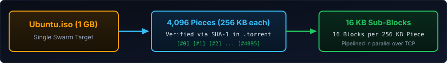

  

    <h3>1. Random First Piece</h3>
    
BOOTSTRAP PHASE

    
When you join a swarm with <code>0%</code>, pick <strong>any random piece</strong> first just to get one complete 256 KB piece verified as fast as possible so you have something to trade!

  

  

    <h3>2. Rarest First</h3>
    
STEADY STATE

    
Inspect neighbours' <code>BITFIELD</code> bitmaps and always download the piece held by the <strong>fewest peers</strong> in the swarm.

    
Prevents the "99.9% stuck" syndrome if the original seeder disconnects!

  

  

    <h3>3. Endgame Mode</h3>
    
FINAL 1%

    
To prevent the last piece from stalling on a slow peer, broadcast requests for all remaining missing blocks to <strong>all active peers</strong>, then send <code>CANCEL</code> once the fastest responds.

  

Note:
[24:00 - 25:30]
Why did BitTorrent feel 10x faster than eMule? Three piece-selection rules working in harmony:
1. **Random First Piece**: When you have 0 pieces, don't ask for rare pieces that only one busy seeder has—grab any common random piece immediately so you can start trading.
2. **Rarest First**: Once you have your first piece, always prioritize the piece that is *least common* among your connected peers. Why? Because if the original seeder goes offline, the swarm collectively holds all rare pieces and can finish the download on its own!
3. **Endgame Mode**: Ever had a download fly to 99% and stall on the last 16 KB because the one peer sending it is on a slow connection? BitTorrent requests the final blocks from *everyone* in parallel and sends a `CANCEL` packet as soon as the first copy arrives.

----

## Game Theory in Code: Tit-for-Tat & The Free-Rider Problem

  

    <h3>Solving the "Tragedy of the Digital Commons"</h3>
    
A famous 2000 Xerox PARC study found that <strong>85% of Gnutella users shared 0 files</strong> (they set upload bandwidth to <code>0 KB/s</code> or moved completed files out of their shared folder).

    <h4>BitTorrent's Choking Algorithm (Every 10 Seconds):</h4>
    <ol>
      <li>Measure the rolling 20-second download rate from all connected peers.</li>
      <li><strong>Unchoke the top 4 peers</strong> who are currently uploading the fastest to <em>you</em> (<strong>Reciprocal Tit-for-Tat</strong>).</li>
      <li><strong>Choke (<code>CHOKE</code> message)</strong> everyone else — refuse to upload to leechers who don't upload back!</li>
    </ol>
  

  

    <h3>Optimistic Unchoking</h3>
    
EVERY 30 SECONDS

    
Wait — if everyone only uploads to people who already upload to them, how does a brand-new peer with <code>0%</code> ever get started?

    
Every 30 seconds, BitTorrent randomly <strong>unchokes 1 extra peer</strong> regardless of their upload rate:

    <ul>
      <li>Bootstraps newcomers into the swarm.</li>
      <li>Discovers whether another peer actually has a faster connection than your current top 4!</li>
    </ul>
  

Note:
[25:30 - 27:00]
Bram Cohen didn't just use networking—he used **Prisoner's Dilemma Game Theory** (specifically Robert Axelrod's *Tit-for-Tat* strategy).
On Gnutella and Kazaa, 85% of users were free-riders. The first thing people did after installing Kazaa was uncheck "Share my folder".
In BitTorrent, you don't earn abstract credits for next week—incentives are enforced **every 10 seconds inside the current swarm**.
Your client unchokes (uploads to) the 4 peers who are uploading the fastest to *you* right now. If you throttle your upload speed to 1 KB/s, fast peers automatically choke you within 10 seconds, and your download speed plummets!
And every 30 seconds, **Optimistic Unchoking** picks one random peer and gives them free upload bandwidth—both to bootstrap newcomers with 0% and to probe the swarm for potentially faster trading partners.

----

## The Culture of the Ratio: Private Trackers, OiNK & What.cd

  

    <h3>Ratio Anxiety (<code>UL / DL &gt;= 1.0</code>)</h3>
    

      

        <code>User: Neo2004 | Up: 42.1 GB | Down: 41.8 GB | Ratio: 1.007</code> 
        Status: Power User (Freeleech Active!)
      

    

    <ul>
      <li>BitTorrent's Tit-for-Tat only enforced reciprocity <em>during</em> a download. Once at 100%, selfish users clicked <strong>Stop</strong> ("Hit & Run").</li>
      <li><strong>Private Trackers</strong> (passkey URLs) enforced strict global ratios: drop below <code>0.6</code>, and your account is banned.</li>
      <li>Spawned the <strong>Seedbox</strong> industry (renting 1 Gbps servers at OVH in Roubaix just to maintain ratio!).</li>
    </ul>
  

  

    <h3>The Library of Alexandria of Music: OiNK & What.cd</h3>
    <ul>
      <li><strong>OiNK's Pink Palace (2004–2007)</strong> & <strong>What.cd (2007–2016)</strong>: Invite-only archives with stricter quality control than major record labels.</li>
      <li>To join What.cd, you had to pass a live <strong>IRC oral exam</strong> on digital audio theory, Fourier spectrograms, LAME <code>-V0</code> vs. <code>FLAC</code> lossless transcoding, and EAC rip logs!</li>
    </ul>
  

Note:
[27:00 - 28:00]
And we have to talk about **BitTorrent Ratios**!
Because BitTorrent's Tit-for-Tat only applied while you were downloading, many users would hit 100% and immediately close their client.
To solve this, **Private Trackers** emerged—communities where every `.torrent` file contained a unique cryptographic passkey tracking your lifetime Upload-to-Download Ratio.
Teenagers who couldn't pass high school math suddenly became obsessed with maintaining a `1.05` ratio, hunting for `Freeleech` torrents, or renting Linux **Seedboxes** at OVH!
And on legendary music trackers like **OiNK's Pink Palace** and **What.cd**, you literally had to pass a rigorous IRC interview on lossless audio engineering, sample rates, and spectral analysis just to get an account!

----

## Wait... BitTorrent Still Had a Central Point of Failure!

  

    <h3>2001–2005: The Tracker Bottleneck</h3>
    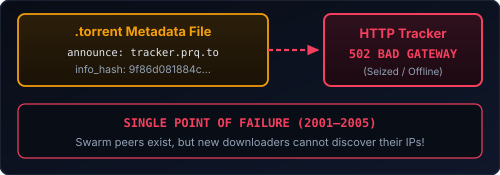
    <ul>
      <li>To join a swarm, your client had to make an HTTP GET request to a central <strong>Tracker</strong> server to get a list of 50 peer IPs.</li>
      <li><strong>2004–2006:</strong> Suprnova.org, LokiTorrent, EliteTorrents, and Razorback are shut down or raided.</li>
      <li>If the Tracker goes down (<code>HTTP 502</code>), new peers cannot find the swarm!</li>
    </ul>
  

  

    <h3>The Ultimate Computer Science Question</h3>
    <blockquote style="font-size: 1.05em;">
      "How can millions of transient nodes store and look up <code>(FileHash -&gt; List of Peer IPs)</code> with <strong>zero central servers</strong> and <strong>without flooding the network</strong>?"
    </blockquote>
    
In 2001–2002, four seminal academic papers answered this simultaneously: <strong>Chord, CAN, Pastry, and Kademlia</strong>.

    
One of them conquered the real world: <strong>Kademlia</strong>.

  

Note:
[27:00 - 28:15]
But wait: early BitTorrent (and early eMule) still had an Achilles' heel!
In BitTorrent, the `.torrent` file contained a URL to a central HTTP **Tracker**. If the MPAA shut down the tracker—like Suprnova or LokiTorrent in 2004—no new peers could find out who was in the swarm.
So computer scientists asked the ultimate question:
Napster had $O(1)$ lookup, but $O(N)$ central vulnerability.
Gnutella had $0$ central servers, but $O(b^{\text{TTL}})$ flooding traffic.
Can we have **zero central servers** AND find any file in **logarithmic time $O(\log N)$**?
Enter **Kademlia**.

----

## Kademlia DHT (Maymounkov & Mazières, 2002)

  

    <h3>1. Unified 160-Bit Address Space</h3>
    <ul>
      <li>Every <strong>Node</strong> generates a random 160-bit <code>NodeID</code>.</li>
      <li>Every <strong>File</strong> has a 160-bit cryptographic hash (<code>InfoHash</code> / <code>ed2k</code> key).</li>
      <li><strong>Core Rule:</strong> A file's peer list is stored on the nodes whose <code>NodeID</code> is <strong>closest</strong> to the file's <code>InfoHash</code>!</li>
    </ul>
    <h3>2. The Genius of the XOR Metric</h3>
    
How do you measure "distance" between two 160-bit IDs $x$ and $y$?

    
$$d(x, y) = x \oplus y$$

    
Bitwise Exclusive-OR (<code>XOR</code>) interpreted as an unsigned integer!

  

  

    <h3>Why XOR ($\oplus$) Is Magical</h3>
    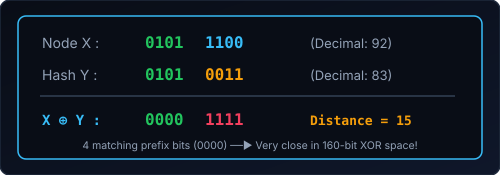
    <ul>
      <li>$d(x,x) = 0$ (Identity)</li>
      <li>$d(x,y) = d(y,x)$ (Symmetry: Node A and Node B agree on their distance)</li>
      <li>$d(x,z) \le d(x,y) \oplus d(y,z)$ (Triangle inequality)</li>
      <li><strong>Unidirectional:</strong> For any point $x$ and distance $\Delta$, there is <strong>exactly one</strong> point $y$!</li>
    </ul>
  

Note:
[28:15 - 29:45]
In 2002, Petar Maymounkov and David Mazières at NYU published the **Kademlia** paper. Both eMule (with the **Kad** network) and BitTorrent (with **Mainline DHT / BEP 5**) adopted it in 2004–2005.
Here is how Kademlia works—and it's one of the most elegant ideas in computer science:
1. Both **Computers (Nodes)** and **Files (Hashes)** live in the exact same 160-bit number space ($0$ to $2^{160}-1$).
2. Who is responsible for knowing which IPs are downloading File $Y$? The nodes whose `NodeID` is mathematically closest to File $Y$'s hash!
3. And how do you measure "closeness" between two 160-bit hashes? **Bitwise XOR ($x \oplus y$)**!
Look at the binary example on the right: if two 160-bit IDs share the first 4 leading bits (`0101`), their XOR starts with `0000`, meaning they are very close! Every matching leading bit cuts the distance in half.

----

## Kademlia $O(\log N)$ Routing & Magnet Links

  

    <h3>Halving the Distance Every Hop</h3>
    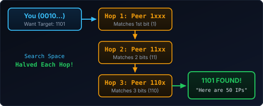
    <ul>
      <li>Each node keeps a small routing table ($k$-buckets) with lots of contacts close to itself and a few contacts far away.</li>
      <li>Each RPC (<code>FIND_NODE</code> / <code>GET_PEERS</code>) resolves at least <strong>1 bit of prefix</strong>.</li>
      <li>In a swarm of <strong>10,000,000 peers</strong>: $\log_2(10^7) \approx \mathbf{24\text{ hops}}$ (~1.5 seconds)!</li>
    </ul>
  

  

    <h3>Nov 2009: The Death of the <code>.torrent</code> Tracker</h3>
    

      

        Pure Content Addressing (BEP 9 + BEP 5)
      

      

        <code>magnet:?xt=urn:btih:c12fe1c06bba254a9dc9f519b335aa7c1367a88a</code>
      

    

    <ul>
      <li><strong>Zero servers. Zero trackers. Zero <code>.torrent</code> files hosted on websites.</strong></li>
      <li>With just <strong>40 hex characters</strong>, your client queries the Kademlia DHT, finds peers matching that <code>InfoHash</code>, and fetches the metadata dictionary from peers (BEP 9).</li>
      <li><strong>Nov 2009 Milestone:</strong> After the 2006 police raid &amp; 2009 trial, <strong>The Pirate Bay permanently deletes its central tracker</strong> — switching 100% to Magnet links so its entire database fits inside a <strong>90 MB text file</strong>!</li>
    </ul>
  

Note:
[29:45 - 30:45]
Because every hop in Kademlia matches at least one more leading bit of the target hash, each step cuts the remaining search space in half—just like binary search across a planet-scale network!
Even if there are **10 million computers** in the BitTorrent Mainline DHT (and today there are regularly 15 to 25 million concurrent DHT nodes!), finding a file takes at most $\log_2(10,000,000) \approx 24$ hops.
Combine Kademlia DHT (BEP 5) with Metadata Exchange (BEP 9) and Peer Exchange (PEX), and you get the **Magnet Link**:
Just 40 hexadecimal characters representing the cryptographic hash of the content.
And the ultimate proof came in **November 2009**: after surviving a 2006 Swedish police server raid and the 2009 trial, **The Pirate Bay permanently unplugged its own BitTorrent tracker** and switched 100% to Magnet Links + DHT—shrinking the entire site's catalog into a 90 MB compressed text file that anyone could mirror on a USB stick!

----

## 2008: ISP Throttling Wars, Bufferbloat & `µTP` (`LEDBAT`)

  

    <h3>Why BitTorrent Broke Home Wi-Fi &amp; Angered ISPs</h3>
    <ul>
      <li><strong>2007 ISP Sabotage:</strong> Comcast &amp; global ISPs secretly throttled BitTorrent by injecting forged <strong><code>TCP RST</code> (reset) packets</strong> pretending to be the other peer — sparking the first landmark FCC <strong>Net Neutrality</strong> investigation!</li>
      <li><strong>The Home "Bufferbloat" Problem:</strong> Standard TCP aggressively fills your ADSL modem's uplink queue until packets drop — causing <strong><code>800ms+</code> ping spikes</strong> that froze web browsing and online gaming for everyone in the house.</li>
    </ul>
  

  

    <h3>Aug 2008: <code>µTP</code> &amp; <code>LEDBAT</code> (BEP 29 / RFC 6817)</h3>
    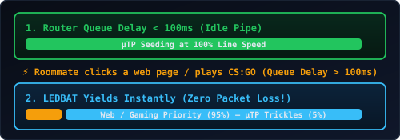
    <ul>
      <li><strong>Built Over UDP:</strong> Enables native NAT hole-punching and defeats naive TCP port throttling.</li>
      <li><strong> Polite Background Transport (<code>LEDBAT</code>):</strong> Measures one-way queuing delay in microseconds and <strong>yields bandwidth before a single packet is dropped</strong>!</li>
    </ul>
  

Note:
[30:45 - 31:30]
On Wikipedia's timeline, **August 2008** marks one of the cleverest networking breakthroughs in P2P history: **`µTP` (Micro Transport Protocol)**.
Remember what happened in 2006 when someone in your house left BitTorrent or eMule running? Nobody else could load a web page or play Counter-Strike!
Why? Because standard **TCP congestion control** keeps ramping up upload speed until your ADSL router's memory buffer is 100% full and starts dropping packets—a phenomenon called **Bufferbloat** that adds 1,000 milliseconds of latency to every click. Worse, in 2007, ISPs like Comcast started secretly injecting forged `TCP RST` packets to kill BitTorrent connections!
So Stanislav Shalunov and Ludvig Strigeus at BitTorrent invented **`µTP` (BEP 29)** and the **LEDBAT** algorithm (standardized as IETF RFC 6817) over UDP:
Every packet carries a microsecond timestamp. The moment `µTP` sees queuing delay on your home router rise above 100 milliseconds—because your roommate clicked a YouTube video—BitTorrent immediately yields the pipe in milliseconds, and resumes full speed the instant the web page finishes loading!

----

## The Last Vulnerability: Public Swarm IPs, Anonymous P2P & I2P

  

    <h3>Why BitTorrent &amp; eMule Aren't Private</h3>
    <ul>
      <li>Kademlia &amp; Magnet links made swarms impossible to shut down — <strong>but every peer in a swarm still sees your home IPv4 address!</strong></li>
      <li>Monitoring bots (RIAA, copyright trolls, <strong>HADOPI</strong> in France) simply joined the DHT/swarm, logged peer IPs, and mailed warning letters.</li>
      <li>This sparked <strong>Anonymous P2P</strong>: <strong>Freenet</strong> (Ian Clarke, 2000), <strong>GNUnet</strong>, <strong>Tribler</strong>, and the darknet masterpiece: <strong>I2P (Invisible Internet Project, 2003)</strong>.</li>
    </ul>
  

  

    <h3>Inside I2P: Garlic Routing &amp; Unidirectional Tunnels</h3>
    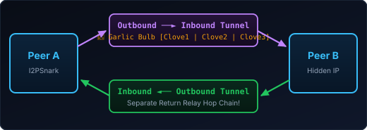
    <ul>
      <li><strong>Why I2P ≠ Tor:</strong> Tor is built to exit to the clearnet web (and hates BitTorrent traffic). <strong>I2P</strong> was engineered <em>specifically</em> for internal P2P overlays!</li>
      <li><strong>Garlic Routing:</strong> Encrypts and bundles multiple independent messages ("cloves") + delivery instructions into a single "garlic bulb" across <strong>unidirectional tunnels</strong>.</li>
      <li><strong>Built-in P2P Ecosystem:</strong> Ships with <strong>I2PSnark</strong> (anonymous BitTorrent) &amp; <strong>iMule</strong> (anonymous Kad/eMule) indexed via I2P's Kademlia <code>NetDB</code>!</li>
    </ul>
  

Note:
[30:45 - 31:45]
Wait: even after BitTorrent and Kademlia defeated server shutdowns, there was still one massive vulnerability for end users: **your public IP address is visible to everyone in the swarm!**
All an anti-piracy firm or government agency (like **HADOPI** in France) had to do was join the torrent swarm, run `GET_PEERS`, and write down every downloader's home IP!
That gave birth to **Anonymous P2P** (like **Freenet**, **GNUnet**, and **Tribler**) and specifically **I2P (The Invisible Internet Project)** in 2003.
People often confuse Tor and I2P, but their architectures are completely different:
- Tor was built for low-latency web browsing out to the normal internet via Exit Nodes.
- **I2P** was designed from day one for **Peer-to-Peer darknet services**! It uses **Unidirectional Tunnels** (separate inbound and outbound chains of peers so a relay never sees both request and response) and **Garlic Routing**—which wraps multiple encrypted messages ("cloves") into a single "garlic bulb" to defeat timing and traffic-analysis attacks. Right out of the box, I2P includes **I2PSnark** (an anonymous BitTorrent client) and **iMule** (an anonymous eMule client)!

----

## Friend-to-Friend (F2F) Darknets: WASTE & RetroShare

  

    <h3>2003: Justin Frankel Strikes Again (<code>WASTE</code>)</h3>
    <ul>
      <li>What if, instead of routing through random strangers on Tor/I2P, your P2P node <strong>only connects to people you trust in real life</strong>?</li>
      <li><strong>May 2003:</strong> <strong>Justin Frankel</strong> (creator of Winamp &amp; Gnutella!) releases <strong>WASTE</strong> at Nullsoft — an RSA-encrypted <strong>Friend-to-Friend (F2F)</strong> mesh protocol for small trusted groups (10–50 peers) with chat and file-sharing.</li>
      <li><strong>History Repeats Itself:</strong> For the <em>second</em> time, AOL panics and pulls Justin Frankel's code off Nullsoft's servers in <strong>under 24 hours</strong>!</li>
    </ul>
  

  

    <h3>Social Trust Graph Routing (<code>RetroShare</code> / <code>Turtle F2F</code>)</h3>
    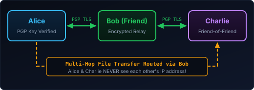
    <ul>
      <li><strong>Zero Sybil or Poisoning Attacks:</strong> Anti-piracy bots cannot join your network unless one of your real-life friends physically exchanges PGP keys with them!</li>
      <li><strong>Plausible Deniability &amp; Multi-Hop Privacy:</strong> You only ever open TCP/UDP sockets to your direct friends' IPs, while searches and file chunks hop anonymously across friends-of-friends (<code>RetroShare</code>, <code>OneSwarm</code>, <code>GNUnet F2F</code>).</li>
    </ul>
  

Note:
[31:45 - 32:30]
And alongside anonymous mixnets like I2P, another fascinating architecture emerged: **Friend-to-Friend (F2F) Darknets**!
First, an amazing anecdote: remember Justin Frankel, who released Gnutella in March 2000 and had it pulled by AOL in 24 hours?
In **May 2003**, still working at Nullsoft, Frankel did it **again**! He released **WASTE**—an RSA-encrypted Friend-to-Friend mesh network for small trusted groups. And once again, AOL lawyers pulled it down within 24 hours!
Later systems like **RetroShare**, **Turtle F2F**, and **OneSwarm** took Friend-to-Friend even further:
Look at the diagram on the right: Alice is friends with Bob, and Bob is friends with Charlie, authenticated by PGP keys. Alice and Charlie don't know each other.
In an F2F network, Alice **only ever connects to Bob's IP address**. Nobody on the internet can scan Alice's port or discover she's running P2P. Yet when Alice searches for a file, Bob forwards the query to Charlie, and the encrypted file chunks flow from Charlie through Bob to Alice—giving you a darknet built entirely on human trust!

----

## 2005–2014: The Megaupload Detour & Popcorn Time Streaming

  

    <h3>2005–2012: Why Direct Download (<code>Megaupload</code>) Rose &amp; Fell</h3>
    <ul>
      <li><strong>The Cyberlocker Boom:</strong> Spooked by P2P swarm IP letters (HADOPI) and ratio rules, millions shifted to HTTP "one-click" hosts: <strong>RapidShare</strong>, <strong>Megaupload (2005)</strong> &amp; <strong>MediaFire</strong> (accounting for 4% of global internet traffic!).</li>
      <li><strong>Jan 2012 (The Napster Lesson Repeats):</strong> U.S. DOJ seizes <strong>Megaupload</strong> domains &amp; raids Kim Dotcom's mansion; <em>FileSonic</em> &amp; <em>FileServe</em> self-destruct overnight.</li>
      <li><strong>Architectural Moral:</strong> Any centralized HTTP vault still has <strong>"one throat to choke."</strong></li>
    </ul>
  

  

    <h3>March 2014: <code>Popcorn Time</code> ("Netflix for Pirates")</h3>
    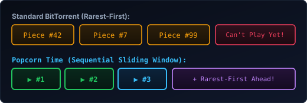
    <ul>
      <li><strong>P2P Strikes Back with UX:</strong> Written in a weekend in Buenos Aires using Node-Webkit + <code>peerflix</code>.</li>
      <li><strong>Sequential Sliding-Window Swarming:</strong> Prioritized the next ~5 MB of video pieces sequentially for instant 1080p playback while keeping <em>Rarest-First</em> for future pieces!</li>
    </ul>
  

Note:
[32:30 - 33:15]
Before we move to Act IV, look at what happened between **2005 and 2014** in the file-sharing timeline:
First, because of P2P swarm IP monitoring and ISP throttling, millions of casual users temporarily abandoned P2P for centralized HTTP "cyberlockers" like **RapidShare** and **Megaupload (launched in 2005)**. At its peak, Megaupload alone carried 4% of global internet traffic!
But in **January 2012**, history repeated the Napster lesson: the FBI seized Megaupload's servers and domains in a single morning, and every competing cyberlocker (*FileServe*, *FileSonic*) panicked and wiped their servers within 48 hours. Centralization had failed again!
And then in **March 2014**, a group of designers and developers in Buenos Aires built **Popcorn Time** in a few days.
Earlier we saw that BitTorrent downloads pieces in *Rarest-First* order—which is great for swarm health, but terrible if you want to watch a movie *right now* because you don't have Piece #1!
Popcorn Time used a hybrid **Sequential Sliding Window**: it forced high priority on the immediate next few megabytes of the MP4 stream so playback started in 5 seconds like Netflix, while still downloading later pieces in Rarest-First order to keep the swarm alive!

---

  ACT IV // THE PLOT TWIST (2005 – PRESENT)
  <h1>P2P Under the Hood of Our Daily Lives</h1>
  
Wait... whatever happened to all those P2P hackers? They built the apps on your phone and the cloud in your data center.

Note:
[31:30 - 32:00]
So around 2010, legal streaming services like Spotify and Netflix took off, and residential P2P traffic share dropped. Did P2P die?
Quite the opposite. The rebels moved inside the castle and used P2P to build modern internet infrastructure.

----

## How µTorrent & BitTorrent Built Spotify!

  

    <h3>From a 100 KB BitTorrent Client to Music Streaming</h3>
    <ul>
      <li><strong>2005:</strong> Swedish engineer <strong>Ludvig Strigeus ("ludde")</strong> writes <strong>µTorrent</strong> in pure C++ — the entire executable is under <strong>100 KB</strong> (while Azureus/Vuze ate 200 MB of JVM RAM!).</li>
      <li><strong>2006:</strong> <strong>Daniel Ek</strong> (former CEO of µTorrent!) and Martin Lorentzon found <strong>Spotify</strong> in Stockholm and recruit Ludvig Strigeus as Lead Architect.</li>
      <li><strong>The Problem:</strong> In 2008, streaming instant audio (<code>&lt; 250ms</code> latency) to millions of free users on cloud server bandwidth would bankrupt Spotify in a month.</li>
    </ul>
  

  

    <h3>Spotify's Secret Desktop P2P Mesh (2008–2014)</h3>
    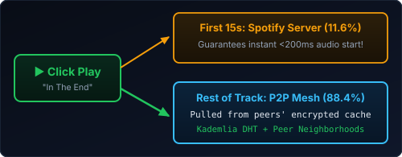
    
<strong>Result (EuroSys 2010 Paper):</strong> <strong>88.4% of Spotify's music bytes</strong> came from peer-to-peer transfers + local cache, and only <strong>11.6%</strong> from Spotify's servers!

  

Note:
[32:00 - 33:45]
Many people don't know that **Spotify was literally built on Peer-to-Peer**.
In 2005, Swedish programmer Ludvig Strigeus created **µTorrent**—a work of art in C++ that packed a full BitTorrent client into a single 100-kilobyte binary.
When Daniel Ek (who briefly ran µTorrent!) started Spotify in Stockholm in 2006, he hired Strigeus to build the streaming engine.
How did Spotify achieve instant `<200ms` playback in 2008 without going bankrupt on CDN bills?
Every Spotify desktop app had a local encrypted cache and joined a P2P overlay network! When you clicked Play on a song, Spotify streamed only the first 15 seconds from its central servers so playback started instantly, while your client simultaneously fetched the rest of the encrypted Ogg Vorbis chunks from other Spotify users who had played that song earlier that week!
According to Spotify's own 2010 EuroSys academic paper, **over 88% of their total audio bandwidth was offloaded to their users' P2P mesh**. P2P didn't get killed by Spotify—P2P *built* Spotify!

----

## OS Updates, AAA Games & Hyperscale Data Centers

  

    <h3>Windows 10/11 Delivery Optimization</h3>
    
1.4 BILLION PCs

    
Ever looked inside Windows Settings → <em>Delivery Optimization</em>?

    
Windows splits cumulative OS updates and Store apps into hashes and shares pieces via P2P across your local LAN (<code>192.168.x.x</code>) and neighboring ISP peers!

  

  

    <h3>Blizzard & AAA Game Launchers</h3>
    
WORLD OF WARCRAFT

    
Remember the <strong>Blizzard Downloader</strong> (<code>TCP 3724 / 6881</code>)?

    
To survive expansion launch days (<em>Burning Crusade</em>, <em>Wrath of the Lich King</em>), Blizzard embedded a real BitTorrent client right inside the WoW patcher.

  

  

    <h3>Uber Kraken & CNCF Dragonfly</h3>
    
CLOUD INFRASTRUCTURE

    
What happens when 20,000 Kubernetes nodes pull a 10 GB ML/Docker image at the same time? The Docker registry melts!

    
<strong>Uber Kraken</strong> & <strong>Dragonfly</strong> use P2P BitTorrent trees inside the data center to distribute container layers in seconds.

  

Note:
[33:45 - 34:45]
Look around the rest of modern software:
1. **Windows 10 and 11**: When Microsoft drops Patch Tuesday for 1.4 billion PCs, it uses **Delivery Optimization**—a built-in P2P swarming protocol that shares chunks across PCs on your office/home LAN and across regional peers.
2. **Video Games**: Blizzard pioneered this in 2004—the *World of Warcraft* patcher was literally a custom BitTorrent client under the hood.
3. **Cloud & Kubernetes**: Inside Uber, Alibaba, and ByteDance data centers, when you deploy a new microservice or AI container image to 20,000 servers at once, a traditional Docker registry collapses (the exact same client-server bottleneck from 1998!). So they built **Uber Kraken** and **CNCF Dragonfly**—peer-to-peer container distribution systems inside the data center!

----

## Git (Linus Torvalds, 2005): The P2P Merkle DAG You Use Every Day

  

    <h3>Every <code>git clone</code> Is a Full Peer</h3>
    <ul>
      <li><strong>Before 2005:</strong> CVS &amp; Subversion (SVN) were like HTTP/FTP — a single central server held the history. Server down? Nobody can commit or diff.</li>
      <li><strong>April 2005:</strong> Inspired by BitKeeper and P2P content-addressing, <strong>Linus Torvalds</strong> builds <strong>Git</strong> in 10 days.</li>
      <li>Every file (<code>blob</code>), folder (<code>tree</code>), and snapshot (<code>commit</code>) is addressed solely by its <strong>160-bit SHA-1 hash</strong> in a <strong>Merkle DAG</strong>.</li>
      <li>Two laptops on a submarine with no internet can <code>git pull</code> and <code>git push</code> directly peer-to-peer over SSH and cryptographically verify 20 years of history from a single root commit hash!</li>
    </ul>
  

  

    <h3>The Irony of GitHub</h3>
    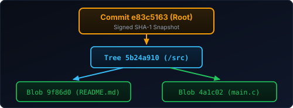
    
Git was architected as a <strong>100% serverless P2P system</strong>.

    
Then we all put <strong>GitHub</strong> in the middle as a central coordination server — accidentally recreating the <strong>Napster Hybrid P2P</strong> topology for source code!

  

Note:
[34:45 - 35:45]
Think about the tool every single developer in this room uses 50 times a day: **Git**!
Before 2005, version control was centralized (CVS, Subversion). When Linus Torvalds wrote Git in April 2005, he designed a pure **content-addressed P2P Merkle DAG**.
Every file blob, directory tree, and commit is identified by a 160-bit SHA-1 hash—just like BitTorrent infohashes and eMule chunk trees! Every `git clone` is a full peer that can exchange objects directly with any other peer without a central server.
And the funniest irony? We took a completely decentralized peer-to-peer protocol and voluntarily put GitHub right back in the center—recreating Napster's hybrid architecture so that when GitHub goes down, everyone stops working!

----

## Cassandra & DynamoDB: P2P DHTs Inside Your Database

  

    <h3>The 2007 Amazon Dynamo Paper</h3>
    
When Amazon needed an "always-on" shopping cart database with <strong>zero master nodes</strong> and <strong>zero single points of failure</strong>, where did they look?

    
They directly adapted the 2001 P2P DHT papers (<strong>Chord &amp; Pastry</strong>) to create <strong>Dynamo</strong> — which gave birth to <strong>Apache Cassandra</strong>, <strong>ScyllaDB</strong>, and <strong>Riak</strong>:

    <ul>
      <li><strong>128-bit Hash Ring:</strong> Both database nodes and row partition keys are hashed onto the exact same circular keyspace.</li>
      <li><strong>Zero Master Nodes:</strong> Any peer can coordinate a read or write and route it to the responsible replica in $O(1)$ hops!</li>
    </ul>
  

  

    <h3>P2P Gossip Protocols in Production</h3>
    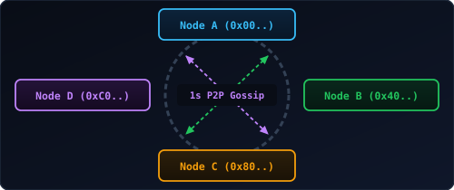
    <ul>
      <li>How do 500 Cassandra nodes know which servers are alive or dead without a central ZooKeeper master?</li>
      <li>Every <strong>1 second</strong>, each node runs an epidemic <strong>P2P Gossip round</strong> (<code>Scuttlebutt</code>) with 1–3 random peers — the direct descendant of Gnutella's overlay!</li>
    </ul>
  

Note:
[35:45 - 36:45]
What about backend databases?
In 2007, Amazon published the famous **Dynamo** paper, and Facebook open-sourced **Apache Cassandra** right after.
If you read Section 4 of the Amazon Dynamo paper, what papers do they cite for their architecture? **Chord and Pastry—the 2001 Peer-to-Peer file-sharing DHT papers!**
In Apache Cassandra and ScyllaDB:
1. There is no master node. Every node is an equal peer on a **Consistent Hashing Ring**—just like Kademlia and Chord.
2. And how do nodes discover topology changes and detect crashed servers? Every 1 second, they run a **P2P Gossip protocol** over TCP/UDP! Next time someone asks if P2P scales to enterprise workloads, remind them that Apple runs over 300,000 Apache Cassandra nodes using P2P DHT rings and gossip!

----

## Tailscale & WireGuard: eMule's "High ID" Grew Up

  

    <h3>Why Legacy Corporate VPNs Sucked</h3>
    <ul>
      <li>Traditional VPNs (OpenVPN / IPsec concentrators) force every packet from your laptop to hairpin through a <strong>central VPN gateway</strong>.</li>
      <li><strong>Tailscale, ZeroTier &amp; Nebula</strong> flipped VPNs to the <strong>Napster / Skype P2P model</strong>:
        <ul>
          <li><strong>Control Plane:</strong> Lightweight coordination server exchanges public keys (<code>WireGuard</code>).</li>
          <li><strong>Data Plane:</strong> Direct, encrypted <strong>Peer-to-Peer UDP mesh</strong> between every device!</li>
        </ul>
      </li>
    </ul>
  

  

    <h3>NAT Traversal Black Magic (UDP Hole Punching)</h3>
    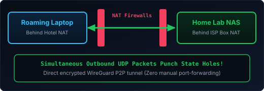
    <ul>
      <li>Uses <strong>STUN, ICE, UPnP/NAT-PMP</strong>, and even <strong>Birthday-Paradox port scanning</strong> to punch through strict carrier-grade NATs without touching <code>192.168.1.1</code>.</li>
      <li>If all else fails, falls back to <code>DERP</code> relay servers — just like 2003 <strong>Skype Supernodes</strong>!</li>
    </ul>
  

Note:
[36:45 - 37:45]
How many of you use **Tailscale**, **WireGuard**, or **ZeroTier** to connect to your home lab or company servers?
Traditional corporate VPNs routed all your traffic through a central choke point. Tailscale asked: why not build a **peer-to-peer mesh VPN**?
And how does Tailscale connect your laptop on coffee-shop Wi-Fi directly to your Raspberry Pi behind your home ISP router without you forwarding port `4662` like we did on eMule?
It uses **UDP Hole Punching**! Both peers coordinate through the control plane and fire simultaneous outbound UDP packets at each other—tricking both stateful firewalls into thinking the incoming packet is a reply to an outbound request! And when faced with hard Symmetric NATs, Tailscale even uses the mathematical **Birthday Paradox** to try 256 random ports until two packets collide in mid-air and open a P2P tunnel!

----

## Apple's 1.5B-Device P2P Mesh & Steam LAN Transfers

  

    <h3>Apple AirDrop &amp; LocalSend</h3>
    
ZERO INTERNET P2P

    
Uses Bluetooth Low Energy (BLE) to discover nearby peers, then spins up a direct peer-to-peer Wi-Fi radio link (<code>AWDL</code> / Wi-Fi Direct) to blast gigabytes between devices on an airplane with zero routers.

  

  

    <h3>Apple "Find My" &amp; AirTags</h3>
    
1.5 BILLION NODES

    
How does an offline AirTag with no SIM card report its location from a forest?

    
It broadcasts a rotating public key via Bluetooth. Any stranger's iPhone walking by encrypts its own GPS location for that key and acts as a <strong>P2P store-and-forward mule</strong>!

  

  

    <h3>Steam Local Network Transfers</h3>
    
150 GB GAMES

    
Installing <em>Baldur's Gate 3</em> on your Steam Deck while it's already installed on your gaming PC?

    
Steam automatically discovers peers on your home LAN and streams verified game chunks <strong>Peer-to-Peer at 1 Gbps</strong> instead of re-downloading from Valve!

  

Note:
[37:45 - 38:45]
And even consumer hardware runs on P2P today:
1. **AirDrop and LocalSend**: Bluetooth Low Energy discovery combined with an ad-hoc Peer-to-Peer Wi-Fi Direct link—no router or internet needed.
2. **Apple's "Find My" Network**: Think about how crazy this is—Apple quietly turned 1.5 billion iPhones, iPads, and Macs into the largest crowd-sourced P2P mesh network on Earth. An AirTag has no GPS and no cellular chip; it just whispers a cryptographic public key over Bluetooth, and any passerby's iPhone becomes an anonymous P2P relay node!
3. **Steam Local Network Game Transfers**: Valve built LAN P2P swarming directly into Steam so your Steam Deck pulls 150 GB game chunks directly from your desktop PC over local Wi-Fi.

----

## WebRTC, NAT Traversal & Hybrid P2P Video Streaming

  

    <h3>eMule's "High ID" Grew Up: STUN / TURN / ICE</h3>
    <ul>
      <li>Remember fighting your router for a High ID on port <code>4662</code>?</li>
      <li>Today, every browser ships with <strong>WebRTC</strong> (<code>RTCPeerConnection</code> & <code>RTCDataChannel</code>), using <strong>ICE + STUN</strong> to perform automatic <strong>UDP Hole Punching</strong> through home NAT routers.</li>
      <li>Every Discord voice channel, Google Meet call, or AirDrop/LocalSend transfer uses P2P negotiation concepts born in the 2000s.</li>
    </ul>
  

  

    <h3>PeerTube &amp; Enterprise Live CDN Offloading</h3>
    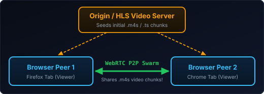
    <ul>
      <li><strong>PeerTube</strong> (Framasoft): Federated + WebTorrent/WebRTC video platform where viewers watching a viral video automatically seed chunks to other viewers in their browser tab!</li>
    </ul>
  

Note:
[35:15 - 36:15]
Remember the nightmare of configuring NAT port forwarding for eMule High ID?
That struggle directly drove the standardization of **STUN, TURN, and ICE** (Interactive Connectivity Establishment), which are now baked into every web browser on Earth via **WebRTC**.
And thanks to WebRTC DataChannels, browsers can now form BitTorrent-like swarms with zero plugins! Open-source platforms like **PeerTube** (and enterprise streaming meshes from Lumen/Streamroot) use this so that if a video goes viral, the viewers watching it in Chrome or Firefox automatically trade `.m4s` video segments with each other over WebRTC, saving small servers from getting crushed.

----

## 2008–2026: From P2P State Machines to AI Weights

  

    <h3>2008: "A Peer-to-Peer Electronic Cash System"</h3>
    <ul>
      <li>Why did <strong>DigiCash</strong> and <strong>E-Gold</strong> fail before 2008? Same reason Napster failed: <strong>a central mint server</strong> that could be shut down.</li>
      <li>Satoshi Nakamoto's 2008 whitepaper combined a <strong>Gnutella-style P2P gossip overlay</strong> with <strong>Merkle hash trees</strong> and solved the <strong>Sybil Attack problem</strong> (what if an attacker spins up 100,000 fake P2P nodes like Overpeer did?) using Proof-of-Work.</li>
    </ul>
  

  

    <h3>2023–2026: Open-Weights AI Dropped via Magnet Links</h3>
    

      

        <code>Mistral AI / Mixtral-8x7B (87 GB):</code> 
        magnet:?xt=urn:btih:554627289065b6a...
      

    

    <ul>
      <li>When <strong>Mistral AI</strong> released its flagship open-weights LLMs, how did they announce it on X/Twitter? <strong>Nothing but a raw BitTorrent Magnet link!</strong></li>
      <li>Why? Because when 100,000 developers pull a <code>90 GB</code> model simultaneously, BitTorrent is still the undefeated king of flash-crowd distribution.</li>
    </ul>
  

Note:
[36:15 - 37:15]
Two more modern plot twists:
1. First, in October 2008, Satoshi Nakamoto published *"Bitcoin: A Peer-to-Peer Electronic Cash System"*. Satoshi explicitly cited the failure of Napster's central servers as the reason digital cash needed a pure P2P gossip network, and used Proof-of-Work specifically to stop the **Sybil attack**—the exact attack where companies like Overpeer spun up 50,000 fake P2P nodes to outvote honest peers!
2. Second, fast-forward to the AI revolution: when French AI lab **Mistral AI** dropped their flagship 87-gigabyte open-weights models, their official launch post was literally a **single line containing a BitTorrent Magnet link**! Even in the age of multi-billion-dollar AI clouds, when 100,000 engineers want a 90 GB file at the exact same second, nothing beats Bram Cohen's 2001 protocol.

---

  ACT V // THE WEB OF TOMORROW (2015 – 2026+)
  <h1>IPFS, libp2p & The Content-Addressed Web</h1>
  
Moving the entire Web from <em>"Where is this file hosted?"</em> to <em>"What is this file made of?"</em>

Note:
[36:45 - 37:15]
And that brings us to our final act: Act V. How P2P evolved from sharing individual files to re-architecting the Web itself with **IPFS** and **libp2p**.

----

## Why Today's HTTP Web Is Surprisingly Fragile

  

    
38%

    <h3>Link Rot (Pew Research, 2024)</h3>
    
38% of all webpages that existed in 2013 are completely gone today (<code>404 Not Found</code>). Over 50% of Supreme Court citations suffer from link rot.

  

  

    
us-east-1

    <h3>Hyperscaler Centralization</h3>
    
When a single AWS region or Cloudflare config hiccups, millions of websites, smart doorbells, and CI/CD pipelines go dark worldwide.

  

  

    
Location

    <h3>The Flaw of <code>https://</code></h3>
    
HTTP asks: <em>"Go to computer <code>104.16.2.1</code> and give me <code>/cat.jpg</code>."</em> Even if the person sitting next to you on the same Wi-Fi already has <code>cat.jpg</code>, you both fetch it from Virginia.

  

Note:
[37:15 - 38:30]
Think about how fragile the HTTP web actually is:
1. **Link Rot**: A 2024 Pew Research study showed that 38% of webpages from 2013 no longer exist.
2. **Centralization**: We took Sir Tim Berners-Lee's decentralized web and put 70% of it inside three cloud providers.
3. **Location Addressing**: `https://example.com/paper.pdf` doesn't name the document—it names a *corporation's DNS domain* and a *file path on a specific server*. If that domain expires, or if someone silently modifies `paper.pdf` on the server, the link breaks or lies to you.

----

## IPFS (Juan Benet, 2015): Standing on P2P's Shoulders

  

    <h3>The Greatest Hits Album of P2P</h3>
    
When <strong>Juan Benet</strong> designed the <strong>InterPlanetary File System (IPFS)</strong>, he didn't reinvent the wheel — he synthesized 15 years of P2P battle-testing:

    <ul>
      <li><strong>Routing Layer:</strong> <strong>Kademlia DHT</strong> (from eMule Kad & BitTorrent).</li>
      <li><strong>Block Exchange:</strong> <strong>Bitswap</strong> (inspired by BitTorrent's swarming + credit ledger).</li>
      <li><strong>Data Structure:</strong> <strong>Merkle DAGs</strong> (inspired by <strong>Git</strong>).</li>
      <li><strong>Naming:</strong> <strong>Self-Certifying File System (SFS / IPNS)</strong>.</li>
    </ul>
  

  

    <h3>Location vs. Content Addressing</h3>
    

      

        HTTP: Location Addressed (Mutable & Fragile)
      

      

        <code>https://central-server.com/uploads/linkin_park.mp3</code> 
        → Server down? 404. Server hacked? Malware served!
      

    

    

      

        IPFS: Content Addressed via CID (Immutable & Verifiable)
      

      

        <code>ipfs://bafybeigdyrzt5sfp7udm7hu76uh7y26nf3efuylqabf3oclgtqy55fbzdi</code> 
        → Fetch from ANY peer on LAN or Earth; verify SHA-256 hash!
      

    

  

Note:
[38:30 - 40:00]
In 2015, Juan Benet created **IPFS (InterPlanetary File System)** by combining the best ideas in distributed systems:
- **Kademlia DHT** for finding which peers hold which data blocks,
- **BitTorrent's** block-swapping engine (generalized as *Bitswap*),
- And **Git's** Merkle Directed Acyclic Graph (DAG) data structure!
Instead of asking *where* a file is (`https://server/file`), you ask *what* the file is via its **CID (Content Identifier)**.
And think back to our 2003 trauma: on IPFS, a fake Linkin Park virus is mathematically impossible if you have the right CID, because changing a single bit of the file completely changes its SHA-256 hash!

----

## Inside IPFS: Merkle DAGs & Deduplication

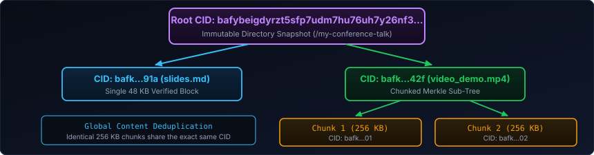

  

    <strong>1. Tamper-Proof Trees</strong> Just like Git commits, the Root CID cryptographically seals the entire folder hierarchy.
  

  

    <strong>2. Global Deduplication</strong> If two files share an identical 256 KB block, they point to the <em>exact same CID</em>.
  

  

    <strong>3. Local-First Speed</strong> If a colleague on Conference Wi-Fi has the CID, your node pulls it over mDNS LAN at gigabit speeds!
  

Note:
[40:00 - 41:15]
Because IPFS structures files and directories as **Merkle DAGs** (just like Git trees):
1. You get **cryptographic verification** of an entire website or dataset from a single root hash.
2. You get **automatic deduplication**: if two versions of a dataset share 95% of their 256 KB blocks, the Merkle DAG reuses the exact same child CIDs.
3. And using local mDNS discovery, two laptops in the same room can exchange IPFS blocks over local Wi-Fi even if the building's internet fiber is cut!

----

## `libp2p` & The Modern Local-First Ecosystem (2026)

  

    <h3>Why <code>libp2p</code> Is Today's Standard P2P Stack</h3>
    
Early P2P networks (Napster, Gnutella, eMule, BitTorrent) each had to build their own monolithic networking stack from scratch.

    
<strong>libp2p</strong> (extracted from IPFS) provides a modular, plug-and-play P2P networking layer in Go, Rust, JS & Python:

    <ul>
      <li><strong>Transports:</strong> TCP, QUIC, WebSockets, WebRTC, WebTransport.</li>
      <li><strong>NAT Traversal:</strong> AutoNAT, DCUtR (Direct Connection Upgrade through Relay / Hole Punching).</li>
      <li><strong>Routing & PubSub:</strong> Kademlia DHT + <strong>GossipSub</strong>.</li>
      <li><strong>Security:</strong> TLS 1.3 / Noise Protocol authenticated by PeerIDs.</li>
    </ul>
  

  

    <h3>Where P2P Lives Right Now</h3>
    <ul>
      <li><strong>Syncthing:</strong> Open-source P2P file sync replacing Dropbox with zero cloud storage.</li>
      <li><strong>Iroh (n0) & Hypercore (Pear):</strong> Next-gen Rust/JS P2P toolkits using BLAKE3 verified streaming & QUIC hole-punching.</li>
      <li><strong>Local-First Software (CRDTs + P2P):</strong> Collaborative apps (Automerge, Yjs) that work offline and sync peer-to-peer without a central database.</li>
      <li><strong>Web3 & AI Data Meshes:</strong> Ethereum Consensus Layer (runs on <code>libp2p</code>), Filecoin, and distributed open-weights AI model torrents.</li>
    </ul>
  

Note:
[41:15 - 42:45]
Perhaps the biggest gift IPFS gave the software engineering community is **libp2p**.
In 2002, if you wanted to build a P2P app, you had to write your own socket layer, your own NAT hole puncher, your own encryption, and your own Kademlia DHT from scratch.
Today, **libp2p** gives you all of that as modular building blocks in Rust, Go, and TypeScript—supporting QUIC, WebRTC, WebTransport, automatic NAT hole punching, and Kademlia DHT out of the box.
Alongside tools like **Syncthing**, **Iroh** (written in Rust using BLAKE3 Merkle trees over QUIC), and **Local-First CRDT apps**, P2P has never been easier for everyday developers to embed into their apps.

----

## 25 Years of Evolution: From Napster to IPFS

<table>
  <thead>
    <tr>
      <th>Generation / Era</th>
      <th>Representative</th>
      <th>Discovery / Routing</th>
      <th>Integrity Check</th>
      <th>Fatal Flaw / Breakthrough</th>
    </tr>
  </thead>
  <tbody>
    <tr>
      <td>Gen 1 (1999)</td>
      <td><strong>Napster</strong></td>
      <td>Centralized RAM Index ($O(1)$)</td>
      <td>None (Filename only)</td>
      <td>Single point of legal & technical failure</td>
    </tr>
    <tr>
      <td>Gen 2a (2000)</td>
      <td><strong>Gnutella 0.4</strong></td>
      <td>Unstructured Query Flooding ($O(b^{\text{TTL}})$)</td>
      <td>None</td>
      <td>Collapsed under its own query packets</td>
    </tr>
    <tr>
      <td>Gen 2b (2001–02)</td>
      <td><strong>Kazaa / eMule</strong></td>
      <td>Supernodes / ed2k Servers + Kad</td>
      <td>9.28 MB MD4 + AICH SHA-1</td>
      <td>Multi-source swarming, survived poisoning</td>
    </tr>
    <tr>
      <td>Gen 3 (2001–05)</td>
      <td><strong>BitTorrent + DHT</strong></td>
      <td>Kademlia XOR DHT ($O(\log N)$)</td>
      <td>256 KB SHA-1 Piece Hashes</td>
      <td>Tit-for-Tat game theory + Magnet links</td>
    </tr>
    <tr>
      <td>Gen 4 (2015–26)</td>
      <td><strong>IPFS / libp2p / Iroh</strong></td>
      <td>Kademlia + mDNS + GossipSub</td>
      <td>Merkle DAGs (SHA-256 / BLAKE3)</td>
      <td>Universal Content-Addressed Web (<code>CID</code>)</td>
    </tr>
  </tbody>
</table>

Note:
[42:45 - 43:45]
Let's step back and look at the entire 25-year arc on one slide.
Look at how every generation solved the exact failure mode of the one before it:
- Napster's central index died in court -> Gnutella decentralized discovery.
- Gnutella's query flooding melted the network -> Kazaa & eMule introduced Supernodes and chunk hashes.
- Free-riders and flash crowds slowed eMule -> BitTorrent introduced Rarest-First piece selection and Tit-for-Tat game theory.
- Trackers got seized -> Kademlia's XOR metric gave us $O(\log N)$ trackerless Magnet links.
- And finally, IPFS and libp2p turned those file-sharing primitives into a universal content-addressed web.

---

  FINALE // DOWNLOAD COMPLETE (100.0%)
  <h1>Don't Just Leech — Keep Seeding!</h1>
  
What looked like teenage anarchy in 2002 was actually the birth of modern distributed systems.

  

    

      <h3>1. Architecture Matters</h3>
      
Centralization is easy to build on Day 1, but fragile at scale. Decentralization turns every consumer into infrastructure.

    

    

      <h3>2. Never Trust Location</h3>
      
Servers go down and filenames lie (<code>Numb.mp3.exe</code>). Cryptographic content addressing (CIDs, Merkle trees) is truth.

    

    

      <h3>3. Align Incentives</h3>
      
The best protocols (like BitTorrent's Tit-for-Tat) don't rely on altruism — they bake fairness directly into the wire protocol.

    

  

  

    

      eMule v0.50a // BitTorrent // IPFS — Transfer Completed!
      _□×
    

    

      <strong>Status:</strong> <code>100.0% Completed — Seeding to Conference Swarm</code>
      Questions & Stories Welcome!
    

  

Note:
[43:45 - 44:30]
To wrap up: the next time you hit Play on Spotify, download a Windows update, deploy a Docker container to a cluster, join a WebRTC call, or fetch an immutable CID over IPFS—remember that stubborn little eMule donkey and that 99.9% progress bar on the family computer.
What looked like teenage piracy was actually the crucible that forged modern distributed systems.

----

## Further Reading: Seminal Papers & Modern P2P Toolkits

  

    <h3>4 Papers Every Engineer Should Read</h3>
    <ul>
      <li><strong>Maymounkov & Mazières (2002):</strong> <em>"Kademlia: A Peer-to-peer Information System Based on the XOR Metric"</em> (IPTPS '02)</li>
      <li><strong>Bram Cohen (2003):</strong> <em>"Incentives Build Robustness in BitTorrent"</em></li>
      <li><strong>Kreitz & Niemelä (2010):</strong> <em>"Spotify — Large Scale, Low Latency, P2P Music-on-Demand Streaming"</em> (ACM EuroSys '10)</li>
      <li><strong>Juan Benet (2014):</strong> <em>"IPFS — Content Addressed, Versioned, P2P File System"</em></li>
    </ul>
  

  

    <h3>Build With P2P Today</h3>
    <ul>
      <li><strong>libp2p:</strong> <code>libp2p.io</code> (Go, Rust, TypeScript, Python)</li>
      <li><strong>IPFS / Helia / Kubo:</strong> <code>ipfs.tech</code></li>
      <li><strong>Iroh (Rust QUIC + BLAKE3 P2P):</strong> <code>iroh.computer</code></li>
      <li><strong>Syncthing:</strong> <code>syncthing.net</code></li>
      <li><strong>Uber Kraken / CNCF Dragonfly:</strong> P2P OCI container distribution</li>
    </ul>
  

Note:
[44:30 - 45:00]
Here are the four classic papers—especially the Kademlia XOR paper, Bram Cohen's BitTorrent incentives paper, and the 2010 Spotify P2P paper—along with modern libraries you can use in Rust, Go, or TypeScript this weekend.
Thank you all! Maintain your ratio, and keep seeding!
